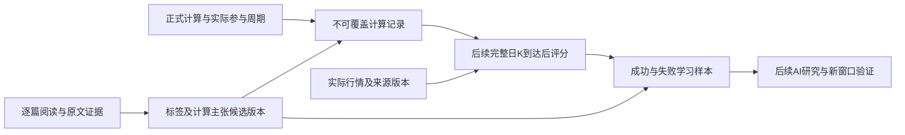

# 价格核对、逐篇笔记学习与样本保存设计

日期：2026-10-16。状态：用户已批准并完成本阶段实施及验收，详见 [验收记录](../../../research/zhangyue-scenario-v1/price-evaluation-implementation-validation.md)。实施期间保留原工作区改动；2026-10-17用户另行授权提交并推送GitHub供本地运行，见[交付说明](../../handoff/2026-10-17-stockcal-local-run.md)。

## 用户目标和已确定标准

让股票参考价的计算、实际行情核对、笔记依据和后续AI研究形成可持续积累的记录。先以掌阅科技603533验证，再保留支持其他股票的结构。

用户已同意第一阶段接入计算记录、自动核对和学习样本库，并补充逐篇学习笔记打标签。准确度以计算价对实际开高低收的偏差严格小于1%为主；盘中反复形成支撑、压力的价位另需分钟证据。逐篇学习要提炼条件与方法，标签本身不证明预测效果。

继续保持日线优先、规律不明确才逐级读小时/30分钟、明确后最多额外核对一个下级周期；相近预测价用1%完整链接分组和算术平均，按收盘和适用涨跌幅保留全部实际价位，不补足固定数量。旧笔记的不同阈值、数量和强制周期要求作为来源差异记录。

## 当前证据和缺口

- 现有标签目录包含146篇笔记、248个片段，均为候选标签；支持原文、修订、人工标签核对及浏览器历史，不能用新的静态版本覆盖已有本地修订。
- 现行情景引擎保存只读版本到浏览器，包含行情、方法、条件路径、实际参与周期、原始及合并参考价、笔记依据和风险规则。
- 现有`scenario-evaluation.ts`核对指标误差与范围覆盖，尚未实现用户最新的开高低收接近评分和持久化学习样本。
- PostgreSQL、后端和前端已在开发环境运行。现有sync保存不透明的可变记录，不适合直接承载新的不可覆盖研究记录及可查询评分。
- 当前公开行情模式未配置`STOCKCAL_API_BASE_URL`，直接打开旧后端接口可能返回502；新记录通道需要独立后端地址配置，避免改变已有公开行情选择逻辑。
- 60个历史日线样本已比较三种方法，提出一条按方向选择方法的候选；其验证表现没有超过更强固定方法，保留为未启用的研究结论。部分验证样本早已查看，不冒充严格盲测。
- 本次逐篇学习依据：[清单与哈希](../../../research/zhangyue-scenario-v1/note-study-2026-10-16/manifest.json)和[研究记录约定](../../../research/zhangyue-scenario-v1/note-study-2026-10-16/review-contract.md)。研究输出与现有产品标签种子分开，附件未核对时保留状态。

## 方案选择与第一阶段边界

采用“独立的后端研究记录和评分接口，复用现有前端与PostgreSQL”。这能保存不可覆盖版本、按条件查询，并在关闭浏览器后继续核对。直接塞入现有通用sync改动少，但其UPSERT与不透明payload不支持所需历史和评估；另建独立研究应用会增加重复行情和界面逻辑。

第一阶段覆盖：保存正式计算、保存逐篇研究建议及来源、核对日线四价、展示学习样本和逐篇学习进度。产品中的AI新规律生成、分钟支撑压力识别和自动选择新算法作为后续阶段；本阶段保留它们需要的证据与状态，不使用未经验证规则改变价格。

## 数据流

### 笔记研究层

每篇保存：文件名、当前原文字节哈希、来源URL、文本阅读覆盖、语义摘要、现有词表标签及逐标签原文行号、计算角色、计算主张、输入、原文周期、适用与失效条件、缺失定义、附件状态、与现行用户规则的冲突。

计算角色区分趋势、葛阶段、参数公式、方法选择、支撑压力、盈利模式、风险、验证和背景。公式仅在原文提供或可无歧义表达时填写；“较大”“适当”“攀升”“开口”“双高”的数值条件未定义时保持缺口。转录歧义和未检查的图片音频不补造结论。

原始标签、AI语义建议、人工选择和效果验证分别记录：

| 信息 | 状态意义 |
| --- | --- |
| 标签及来源解释 | AI候选 / 人工核对；只说明文字理解 |
| 计算条件 | 可直接计算 / 缺定义 / 缺数据 / 仅解释 |
| 研究效果 | 未测试 / 测试记录 / 支持范围不足 / 未通过 |
| 正式使用 | 本次明确选择的规则或解释版本 |

BOLL一期/二期/三期与葛兰碧第几根分别建模，不能共用一个stage字段。笔记提及“葛二”只说明适用条件；某股票当次的葛阶段仍须绑定股票、周期、起点事件和当次确认来源，不从文档标签直接赋值。

现有本地人工修订可能已到v2、v3。新的全量AI研究不能直接改写静态v1或用一个更高版本替换它们；使用独立的studyRevisionId、channel和parentRevisionId，人工选择时明确引用所选建议。旧快照仍显示原有标签与原文版本。

旧引用迁移保留`legacyRecordId + level(document/fragment) + sourceHash + tagVersion + owner/channel`作为完整映射键，连同该版本的原标签和引文原样上传并幂等生成UUID。导入到研究库只建立映射，不解析成“当前最新版本”。快照继续内嵌旧引用和原文证据；尚未找到对应本地历史时明确标为引用未解析，不用同文件的新标签代替。

### 计算记录

用户点击既有“保存分析”时冻结一次正式计算，保留当前浏览器备份并尝试入库。未保存的草稿更新不自动生成数据库版本。界面显示“仅本地、待同步、已入库、失败可重试”，只有后端确认后才显示已入库。

每次保存包含原完整快照和：客户端计算ID与版本、serverReceivedAt、clientCreatedAt、inputAsOf、来源模式、股票、最近完整日K、实际参与周期、方法及条件路径、合并和涨跌幅定义、原始与最终全部价位、原文及所用标签/研究版本引用。服务端接收时间由服务端产生，不能由客户端回填。

研究记录维持append-only。相同拥有者、客户端计算ID、版本及相同规范payload哈希返回同一记录；同一键不同payload返回409，不能覆盖旧价格。修订新增版本并引用上一版本。

### 数据库结构

新增三个研究领域表，使用后续Flyway迁移号；不改变现有交易、sync或已发布规则表。

1. `scenario_forecast_record`：拥有者、UUID、client_record_id、client_version、previous_record_id、symbol、kind、received_at、client_created_at、input_as_of、anchor_day、method、definition_version、payload_hash、payload_text及目标选择策略。唯一键为拥有者与客户端ID/版本；按拥有者、股票、接收时间及待核对状态索引。
2. `scenario_price_evaluation`：UUID、forecast_id、evaluation_version、previous_evaluation_id、target_resolution_version、target_resolution_state、target_day、resolution_evidence、actual_candle_hash、raw_response_hash、actual_fetched_at、evaluated_at、definition_version、eligibility/status、next_retry_at、总价位数与接近数、四价覆盖项数、结果payload_text。目标解析、核对状态及修订逐次追加，目标未核实时不产生成功评分。实际柱的哈希只覆盖来源标识、股票、不复权口径、目标日及该柱OHLCV；采集时间和原响应字节哈希另存，避免仅刷新采集时间就生成新评分。相同预测、目标解析版本、实际柱哈希和评估定义幂等。
3. `note_study_revision`：UUID、拥有者/共享种子范围、source_file、source_hash、source_text、source_url、channel、parent_revision_id、created_at、tag_ids、study_payload_hash、study_payload_text。引用时用稳定UUID与source_hash，不把标签核对状态等同效果验证。

完整快照和结果按不透明JSON文本存储，按需查询的字段单列；JDBC绑定沿用现有文本payload经验。学习样本库从预测与评估关联查询得到，不再复制另一套价位与评分。

## 自动评分定义

使用`ohlc-price-closeness-v1`：P为冻结快照实际显示的、按最小报价单位取整后的价格，A为目标完整日K的实际四价之一。

`相对偏差 = abs(P-A)/A`。P、A为正的整数分时，以整数比较严格实现小于1%，例如`abs(pCents-aCents)*100 < aCents`，不能用显示为1.00%的字符串判断。价格精确到分相同另记exactMatch。

每个计算价保存对开、高、低、收四项误差、最近项和全部符合项；任一项接近，该价位通过四价接近标准。反向列出四个实际目标分别是否被某价接近。一个计算价可覆盖多项，不能把两种分母混成准确率或胜率。

全部实际价位进入评分，包括未接近的价位；不按结果选优方法、填补价位或删失败项。没有价位时记录空集合，接近比例为null并保留空集状态；明确对照“每日研究选择分数”的空集计零策略时需另标版本，不把null改成成功。未来第1/2/3根指标参考可以用于同一预先选定的执行窗口，保留每条来源的周期和根数。

原图范围包含某个价格与反复支撑/压力是不同证据；本阶段只有日线时，后者为未评估。MA/BOLL自身误差、价位范围覆盖和交易盈亏继续分别记录。

## 目标日与时点

第一阶段默认目标策略固定为“基准日之后来源中首根完整日K”，由未来首次满足条件的日K确定，不按后续涨跌挑选窗口。未核实交易所日历时，不预先推算节假日，不把缺日认定为休市；页面明确称后续首根完整日K。

目标解析作为评价版本的一部分保存`targetResolutionVersion/resolvedTargetDay/resolutionEvidence`，首次确定后不能原地改变。来源显示跨自然日缺口时，先保留候选目标并标记`target_unverified`，不自动认定休市、停牌或跳过缺日，也不计入默认学习统计；核实日历/停牌或完整来源证据后再确认。若来源后来补发更早的后续日K，依据补发与日期证据追加目标解析修订，旧目标评分保留历史并退出默认统计，不按哪一天价格更接近来选目标。

只有完整日线可评分，交易时区为Asia/Shanghai。当天未到15:00的柱保持待核对；采集或行情失败是待重试/缺数据，不能当作未命中。接近收盘的延时修订保留实际采集时间，后续来源修订追加评价版本。

全日四价前瞻资格首版采用保守的盘前截止：目标日北京时间09:15，即开盘集合竞价开始之前。每个计算版本自己的首次服务端接收时间、客户端生成时间与inputAsOf都必须早于该截止；后续修改版本不能沿用旧版本的早期接收时间。09:25已形成开盘集合竞价结果，不能复用现有范围覆盖函数的09:30日窗起点来证明四价预测有效。

浏览器旧记录后来上传、历史回放或截止后保存的记录，可以作事后对照，但不得计入事前效果。不能用客户端声称的早期createdAt冒充盘前已保存。第一阶段不能用全日OHLC评价盘中保存之后的局部窗口；该模式需后续更细行情支持。

服务端检查完整柱不晚于inputAsOf、股票与不复权口径一致、价位来源及版本定义完整、最终列表与冻结合并/范围筛选一致。客户端计算结果保留客户端来源标记；本阶段不把接收并保存等同服务端独立验证了所有形态识别或未来预测。

## 后端、行情和接口

新增独立研究记录/评估领域服务。复用现有Principal身份；现有免登录开发模式继续用X-Client-Id形成web身份，鉴权开启时继续要求登录，不改变安全模式。

接口均由Next同源BFF调用：

| 方法与路径 | 用途 |
| --- | --- |
| POST `/api/v1/scenario-records` | 幂等保存冻结计算记录 |
| GET `/api/v1/scenario-records?symbol=603533&cursor=...` | 当前身份的分页历史 |
| GET `/api/v1/scenario-records/{id}` | 原始快照与冻结依据 |
| POST `/api/v1/scenario-records/{id}/evaluate` | 使用后端行情适配器即时核对；无完整行情时返回待核对 |
| GET `/api/v1/scenario-records/{id}/evaluations` | 不可覆盖评估历史 |
| POST `/api/v1/note-studies` | 幂等导入有原文证据的语义研究版本 |
| GET `/api/v1/note-studies?file=...` | 逐篇研究与版本对照 |
| GET `/api/v1/learning-samples?symbol=...` | 筛选预测、评估及笔记依据的关联样本 |

分页使用稳定游标，拥有者从服务端身份取得，不接受请求体跨用户指定。游标同时固定查询时点和PostgreSQL事务可见性快照；采集完成时间用于评价时点，查询开始时未提交的预测、评价及研究版本均不得混入后续批次。服务端要求每条标签证据及每条计算主张都有完整、非空的行号／引文，并核对其在对应source_hash原文的行范围内，拒绝损坏来源和未知标签。

后台定时任务定期检查待核对记录；同时可手动重试。失败按记录追加状态及下一次重试时间，重复请求不会生成重复评分。重启后依据数据库最新状态继续核对，不依赖浏览器标签页常驻。

首次成功后继续在随后7个自然日内每日复查实际柱哈希；以后可手动重评。相同实际柱不追加评分，修订才追加新成功版本。每个预测/当前有效目标解析版本/评分定义，默认统计只取最新成功评价；旧版只供历史对照，复查失败保留上次成功结果并显示故障状态。冻结研究数据集必须绑定具体评价ID及哈希，避免后续修订静默改变已报告结果。7日以外的历史修订不声称自动发现。

实际行情从后端日线适配器取得，使用已配置供应商；开发公开行情模式补充与当前前端同口径的腾讯不复权日线适配，保留来源、采集时间与原始结果哈希。只补实际日线读取，不因此额外运行小时或30分钟预测。行情访问遵循现有代理和CA设置。

记录BFF采用`STOCKCAL_RECORDS_API_BASE_URL`，未提供时可回退已配置的`STOCKCAL_API_BASE_URL`；它独立于公开行情选源。开发实例可把记录地址指向已运行的后端，同时继续使用前端公开行情。未配置时返回明确的未连接状态，本地保存与导出继续可用。第一阶段不需要AI服务凭据。

## 页面变化

1. 情景分析面板：既有“保存分析”增加云端状态与重试；保存快照后查看“价格核对”。展示目标日、实际四价、每价四项误差与接近标记，以及未覆盖的高低点。历史原价和采用周期只读。
2. 笔记标签工作台：增加“逐篇学习建议”视图，展示146篇覆盖进度、语义建议与现有标签的差异、计算主张、缺定义及引用。AI建议不会覆盖用户现有标签。需要时由用户选择写入其研究版本。
3. 学习样本视图：按股票、日期、算法版本、候选趋势/人工确认趋势、笔记来源和评估状态筛选，展示成功和失败，区分前瞻有效与事后回放。未确认葛阶段保持未知。
4. 导出包含冻结预测、对应评估、实际行情依据、所引用笔记研究版本及各自哈希；避免现有“详见导出”但导出缺评价的情况。

## 后续AI学习契约

以本阶段保存的样本为输入，先总结再固定一条或有限数量候选规则，在新的时间窗口验证。用过的验证资料转为已见，不能反复当作未见数据。候选含公式/方法、输入、适用条件、缺失定义、反例、样本范围和版本；来源是笔记与AI新假设时分别标记。

AI研究结果与既有知识发布流程分开，现有复盘客户端只能解释交易事实，不直接承担产生新价格规律的工作。后续使用结构化研究请求和受限计算模板；AI提供的文本不直接作为可执行代码。当前接口凭据未配置不妨碍先完成保存与评分，凭据在后续接入时通过环境设置提供。

## 验收

- 原始notes哈希和现有浏览器标签修订保持原样；146篇语义研究每条标签和主张都有可核对引文，附件与定义缺失有明确状态。
- 默认只读取日线，按需下钻限制保持；数据库只保存实际参与周期，标签研究不能强制加载额外周期。
- 14日收盘、仅日线、平均增量的既有回放，对15日实际开29.51、高32.91、低28.95、收29.01，应复现5个计算价中2个接近、四价覆盖3项；最高价误差6.56%，不覆盖。明确为事后回放。
- 明确以A为分母的有序用例：P=101、A=100恰好1%不通过；P=100.99、A=100通过；P=100、A=101约0.9901%通过；完全一致另记。全部未命中价与未覆盖目标可见，空集、缺数据、未结束窗口不伪装为0误差或成功。
- 相同计算版本重复保存只产生一行；不同payload冲突409；修订和行情修订追加版本。用户及web身份间记录隔离。
- 验证09:15前后及09:25后保存的资格边界，每个修订独立计首次接收时间；后来上传的旧浏览器快照不冒充事前计划。篡改未来K线不会改变已冻结预测价。
- 先返回16日、后补发15日的来源缺日案例保持目标解析与修订历史；默认样本不重复统计旧目标和旧评分。已完成后来源修订可在复查期发现，故障保留最后成功结果。
- 后台任务重启后可继续；行情失败不覆盖旧结果，重新可用后只追加所需评价，不把故障当作预测失败。
- 浏览器桌面/手机验证保存、离线/失败重试、逐价核对、笔记原文/版本、学习样本过滤和导出；后端使用真实PostgreSQL验证迁移、持久化、唯一约束和重启。
- 运行受影响的前后端测试、前端lint/build和相关浏览器检查。新阶段未实现前，不用已有573项测试作为本阶段已通过的证据。

书面设计审阅通过后再写实施计划并开始产品修改；逐篇原文研究和已有离线验证记录已作为独立证据继续完成。
